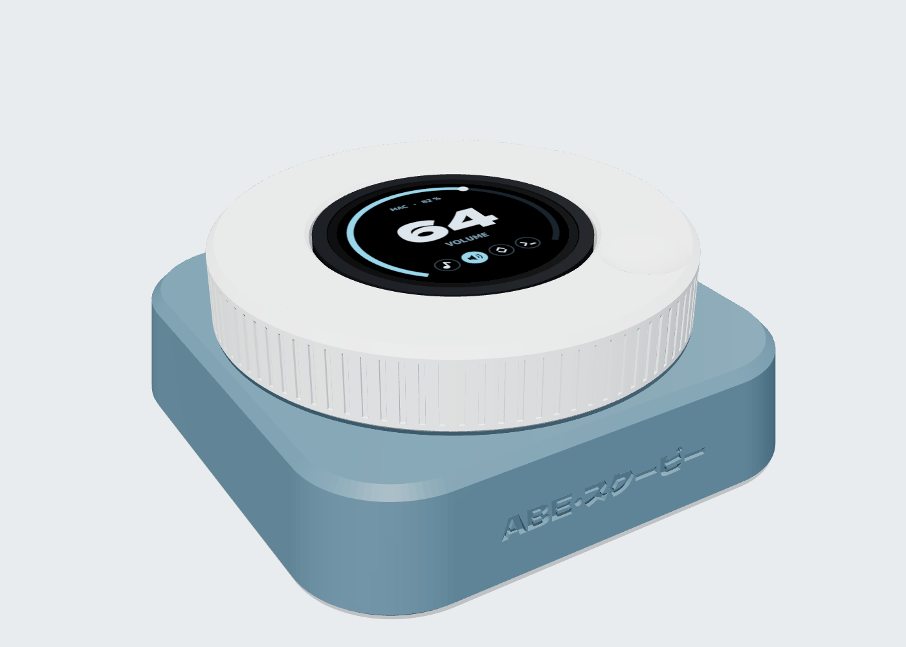
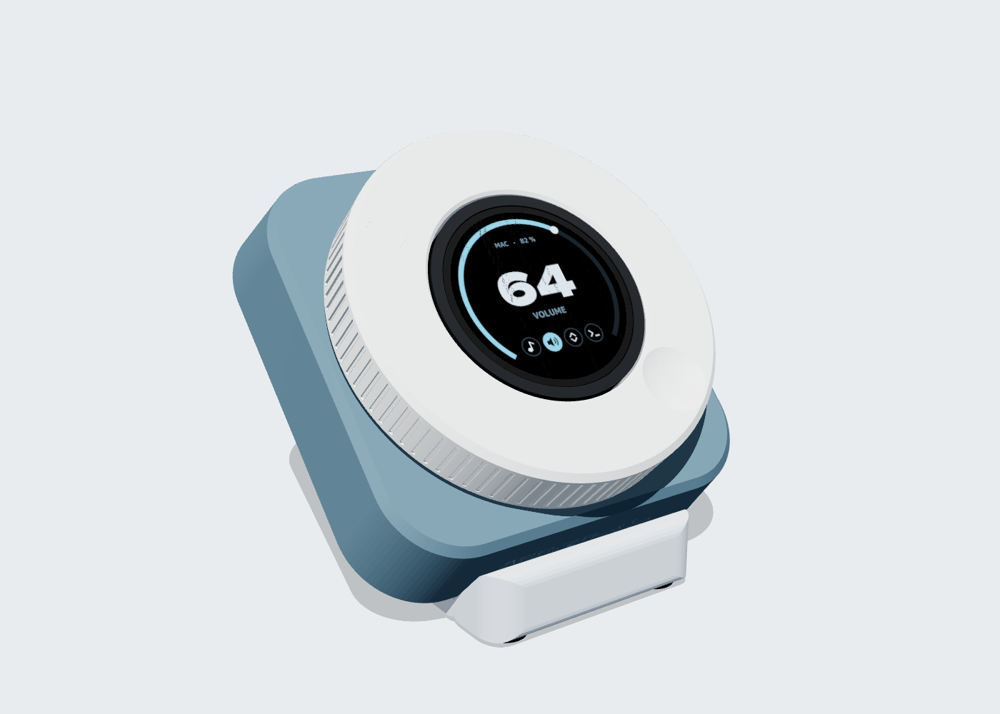
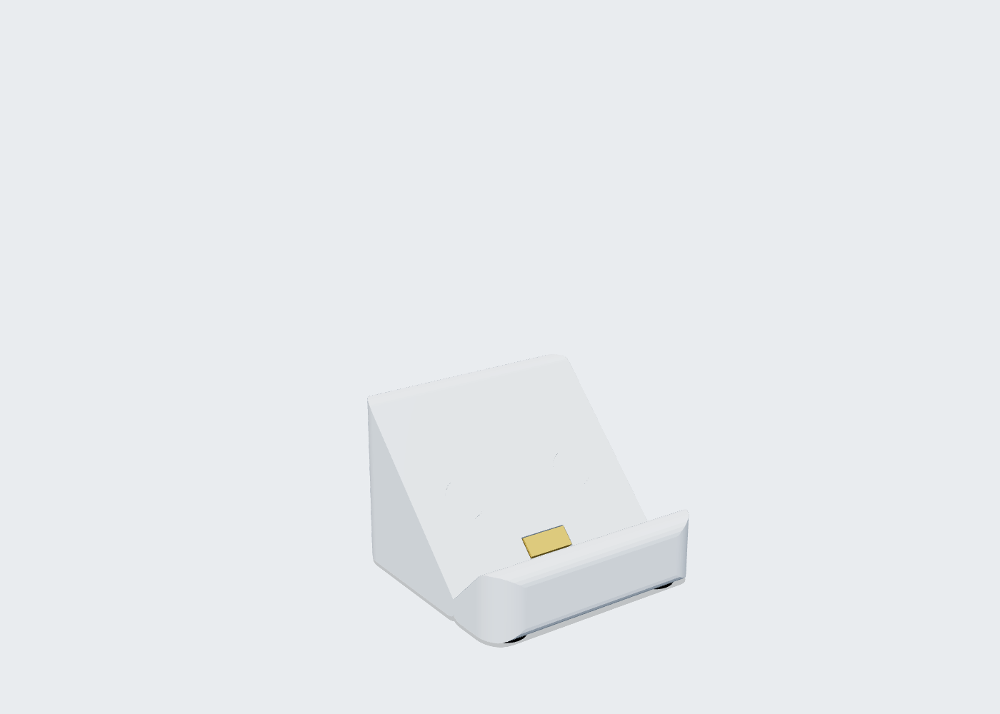
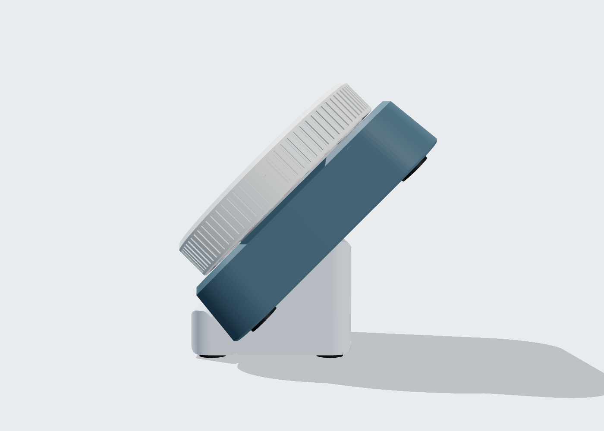
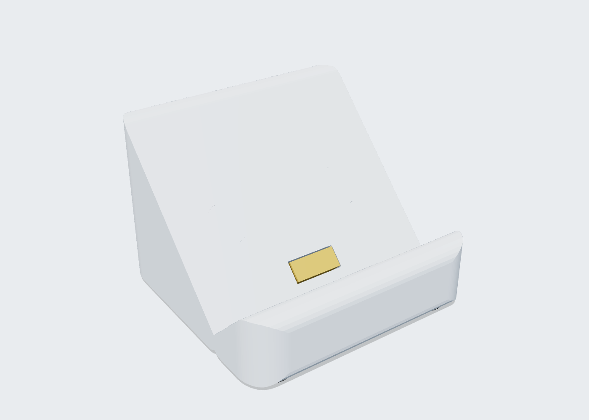
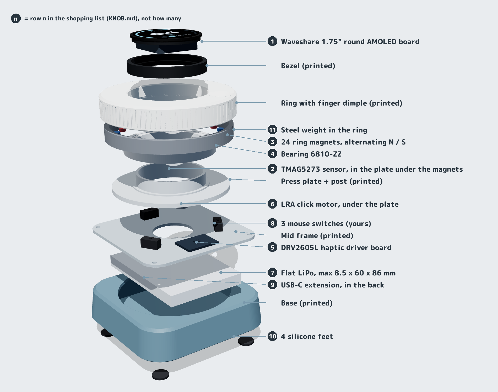

# Desk knob

A wireless knob for the desk. A big printed ring with a finger dimple turns
around a round touch screen. The screen says what the ring does right now
(Spotify, volume, scrolling, terminal history…), so there are no button
combinations to remember. It runs on a battery in a square base, so it can
sit next to the Prospector, by the trackpad or on your knees. A small dock
with a 45° slot holds it like a mixing-desk control, the way headphones sit
in a charging stand.

**Status (2026-11-06): concept only.** Renders to look at and tweak, plus
the shopping list. Nothing has been bought, and there are no print files yet.



| In the 45° dock | Same view, knob taken out |
|---|---|
|  |  |
|  |  |



These are copies in `img/knob/`. `case/knob/build.sh` writes every render
to `case/knob/renders/` (not in git), including `front`, `top`, `cutaway`,
`dock-back` and `screen-ui` (the mock screen), and refreshes these copies.

## To do

- [ ] **You: measure your magnets**: diameter × thickness, and how many you
  have. Their size sets the pockets in the dock and the knob.
- [ ] **Magnets on both sides, so the knob snaps into the dock.** Today the
  dock has 2 magnets that pull on 2 steel discs in the knob's bottom. With
  magnets in the knob too (opposite poles facing), it snaps in harder and
  centres itself. The catch: the knob's floor is only 2 mm, with the battery
  right above it, so magnets thicker than about 2 mm need a small bump inside
  the base or the battery moved back. The model changes once your sizes are in.
- [ ] **You: find a magnetic charging connector** of the kind where one part
  stays in the device for good. Send its measurements: the size and depth of
  the part that stays in the knob, how many contacts it has, and whether it
  carries data.
- [ ] **Then place it:** the part that stays goes flush in the knob's bottom
  near the front edge. There it's hidden when the knob lies on the desk and
  meets the dock when docked. The other part goes in the dock's back face,
  with a USB-C socket in the back of the dock. If it's a magnetic USB-C tip
  that carries data, it could replace the USB-C extension in the back of the
  base: one port for charging off the dock, docking and flashing.
- [ ] The "Before ordering" checks further down.

## What it has to do

- **Battery, never a cable.** It must be free to move around: by the
  Prospector, by the trackpad, on your knees for lazy web surfing. A bigger
  battery is fine.
- **Round touch screen** in the middle. Tap an icon (Spotify, Volume, Scroll,
  Terminal…) to choose what the ring does.
- **A big ring, bigger than the screen, with a finger dimple**, so one finger
  can spin it (scrolling web pages). No big flat knob is for sale, so it's
  printed.
- **Magnet sensing and software clicks.** No EC11-style mechanical encoder.
- **Square base** that holds the battery, in the spirit of the SmartKnob
  View's base.
- **45° dock**: a slot it drops into, like a headphone charging stand, to
  see the screen and use it like a mixing desk. Bad for ergonomics, fine for
  changing the volume or skipping a song. It should be small and hardly
  noticeable when the knob isn't in it.
- *Nice to have:* press the whole knob down to click, using 3–4 spare mouse
  switches.

## How it works

| Part | What it does |
|------|-------------|
| **Ring** (printed, Ø94 × 16 mm) | The knob. The finger dimple (Ø17, 2.5 deep) sits near the edge, the side is knurled, and a steel weight in the underside makes it coast when you flick it. It turns on a thin 6810-ZZ bearing round a fixed centre post. |
| **Screen** (fixed in the middle) | The Waveshare board *is* the computer: an ESP32-S3 with Bluetooth, the touch AMOLED, battery charging with a level readout (AXP2101), and a motion sensor (QMI8658) that can wake it when you pick it up. On an AMOLED, black pixels are off, so a black UI saves battery. |
| **Sensing** | 24 small magnets, alternating N/S, sit in the ring's underside. A TMAG5273 3D Hall sensor below them reads the field's angle, which does one full turn per magnet pair, so you get fine resolution. Nothing touches, so nothing wears and it's silent. The sensor's wake-up mode (~1 µA) wakes the ESP32 when the ring moves. |
| **Clicks** | A DRV2605L haptic driver with an LRA (the Taptic Engine kind of motor) taps once per step: fine ticks for volume, one per line for terminal history, none for free scrolling, a bump at 0 and 100 %. *Option:* real clicks with no power at all, from a small magnet on a slider in the base pulling on the ring's magnets. Slide it away and the ring spins smooth. |
| **Press** (optional) | The ring, screen and press plate float about 0.6 mm on 3 mouse switches wired in parallel, so pressing anywhere clicks. The firmware ignores clicks while the ring is turning. If the board's power-button pin can be reached, the same press could also be on/off (long press). |
| **Battery** | A flat LiPo on the floor of the base. Charging goes through a USB-C extension to the back of the base, or through the dock (below). |
| **45° dock** (printed, 60 × 60 × 42 mm) | A small block with a V-shaped slot. It is narrower than the knob, so it hides behind it, and the knob's feet hang past its sides. The knob's front edge drops into the slot and its bottom rests on the slot's back face. Two magnets under that face pull on two steel discs flush in the knob's bottom (magnets on both sides is on the to-do list), so it snaps in and a tap on the ring can't tip it backwards. The screen centre ends up 71 mm above the desk. |
| **Charging in the dock** | A magnetic charging connector, with one part that stays in the knob for good (a magnetic USB-C tip or a magnetic pogo pair; you're picking one). That part sits flush in the knob's bottom near the front edge, hidden when it lies on the desk. The other part goes in the dock's back face, and a USB-C socket in the back of the dock. The model shows a 12 × 5 mm stand-in. Docking it charges it, like a headphone stand. A diode on each charge input keeps the dock and the USB-C cable apart if both are plugged in. |

**Battery estimate (a guess until measured):** with a 3000 mAh pack and
about an hour of use a day, roughly 2–4 weeks per charge. The drain is
mostly the ESP32 keeping the Bluetooth link alive. It could reach about a
month if it drops to deep sleep after a long idle, at the cost of a 1–2 s
reconnect when you come back.

**Firmware sketch:** ESP32-S3 with Arduino or ESP-IDF, plus LVGL (Waveshare's
examples use LVGL 8.4). It is a Bluetooth HID device: media keys, a mouse
wheel for scrolling and arrow keys for history. It pairs with several
computers, and a screen icon picks which one is active. The screen turns off
after a few seconds and wakes on touch, on turning or on pick-up.

## Shopping list

Prices are rough, in kronor, including VAT and shipping. **Qty** is how
many to buy. The numbered circles on the exploded image are the **#** of
the row here, not how many (so it's 1 sensor, 1 LRA and 1 haptic driver).
**Search for** is what to type in the shop's search box.

| # | Part | Qty | Search for | Notes | ~kr |
|---|------|-----|------------|-------|-----|
| 1 | **Waveshare ESP32-S3-Touch-AMOLED-1.75**, standard version without case | 1 | `ESP32-S3-Touch-AMOLED-1.75` (Waveshare SKU 31261) | Waveshare store, AliExpress (Waveshare's own shop) or The Pi Hut. **Not the `-G` (GPS) version**: its GPS takes GPIO17/18, two of the three free header pins | 350–450 |
| 2 | **TMAG5273 3D Hall sensor board**, A2 version | 1 | `Adafruit 6490`; in Sweden: Electrokit art. 41036412, 92 kr + shipping = 141 kr ("TMAG5273 (A2) - Qwiic", Adafruit; **decided 2026-11-16: buy the real Adafruit, not the 62 kr AliExpress clone**, which is often A1 and has no Qwiic). Confirm the listing says **A2** | The A2 (±133/266 mT), not the A1: strong magnets 1–2 mm away max out the A1. Add **Qwiic to 4× Dupont, cable for the board end: MALE (the board's header is a female socket, see Open questions)**, 150 mm (Electrokit "Qwiic anslutningskabel 4x stift"; the 100 mm female art. 41023467 is the wrong gender here): board header → sensor, sensor's 2nd Qwiic port → DRV2605L. Black GND → header pin 2, red 3.3 V → pin 3 (not pin 1, that's 5 V), blue SDA → pin 6 (GPIO17), yellow SCL → pin 7 (GPIO18). The sensor's INT pin is not in the Qwiic cable: one extra wire to pin 8 (GPIO16). Dupont plugs are tall, so for the final case these are probably soldered instead | 100–140 |
| 3 | **The 24 ring magnets: neodymium discs Ø5 × 2 mm, N52, axially magnetised** | 30 (24 + 6 spare) | `S-05-02-N52N` on supermagnete.se, or on AliExpress `neodymium magnet 5x2mm N52` (50-pack) | **Buy these new, all in one batch**, so all 24 are equally strong. Your own (stronger) magnets go in the dock (#13), not the ring: 24 magnets have to fit round the ring about 10 mm apart, so Ø5 is about the limit, and bigger ones would also max out the sensor. supermagnete is about 3–4 kr each, AliExpress less | 40–120 |
| 4 | **Bearing 6810-ZZ** (50 × 65 × 7 mm) | 1 | `6810ZZ bearing` | **ZZ** (metal shields), not 2RS (rubber seals drag). Wash out the grease and add a drop of light oil for a free spin | 50–100 |
| 5 | **DRV2605L haptic driver board** | 1 | **Changed 2026-11-21: ordered the Adafruit 2305 from DigiKey (`1528-1346-ND`), which has Qwiic ports** (earlier plan: AliExpress module with solder pins). **Decided 2026-11-16: connect by cutting the 2nd Qwiic cable** (Dupont end off, wires soldered to the board; Qwiic end plugs into the sensor's 2nd port), so the board adds no height. Order **2 of the 150 mm male cables** in total; if it doesn't respond, tie EN to 3.3 V | Adafruit's is about 85 kr at RS Sweden; AliExpress clones about 40 kr | 40–85 |
| 6 | **LRA click motor: Vybronics VG1040003D**, 10 mm coin (10 × 4 mm, 170 Hz, 2.5 Vrms) | 1 | `VG1040003D` (DigiKey, Mouser) | About 65 kr at DigiKey. It has contact pads, not wires: solder on two thin wires. **Same size with wires already on:** Precision Microdrives `C10-100` (10 × 3.7 mm, 175 Hz). **Cheap AliExpress option:** `0832 LRA linear vibration motor` (8 × 3.2 mm, 235 Hz, with wires; fits the same spot). It must say **LRA** or "linear": a plain "coin vibration motor" is an ERM and only buzzes. The firmware runs the DRV2605L at the LRA's own frequency (Vybronics advises open-loop at 170 Hz for this one). **Checked 2026-11-06:** no Swedish shop stocks an LRA (Electrokit, Kjell, Botland). Cheapest real one: DigiKey `VG0832012` (8 mm, 235 Hz, wires on), about 40 kr incl. moms, but DigiKey charges 170 kr shipping below 615 kr, so only order it as part of a bigger DigiKey order. Until then, start with the ERM coin motors from the AliExpress order: the DRV2605L's ERM click effects (overdrive + braking) give a short tap, softer than an LRA. An LRA salvaged from an old phone also works, since the DRV2605L finds its frequency by itself | 30–70 |
| 7 | **Flat LiPo, ~3000 mAh**, with a protection circuit, **no bigger than 8.5 × 60 × 86 mm** | 1 | `805080 lipo 3000mAh` | The size code reads thickness-width-length: 805080 = 8 × 50 × 80 mm. The board takes a **2-pin MX1.25** plug. **Check the polarity with a multimeter before plugging in**: sellers wire it both ways | 100–150 |
| 8 | Mouse micro switches | 3 | — | **You have these (checked 2026-11-16):** 3 × Omron D2FC-F-7N(10M), same footprint as the modelled D2F; use COM + NO only. The small square yellow-button 2-pin switches (unmarked, probably tactile) are a fallback only | 0 |
| 9 | **USB-C panel-mount extension**, male to female with screw ears, 15–20 cm, angled male end if possible | 1 | `USB C panel mount extension cable` | Brings charging/flashing to the back of the base | 40–80 |
| 10 | Silicone bumper feet | 8 | `silikonfötter` / `gummifötter` (Clas Ohlson, Biltema) | 4 × Ø12 mm for the knob, 4 × Ø10 mm for the dock | 20–40 |
| 11 | Steel weight: **3 mm steel balls, 220 pcs, about 24–30 g (ordered)** | 1 pack | `stålkulor 3 mm` | Poured into the ring's underside channel (3.4 mm wide, 9.6 mm high, 3 layers, room for about 250) and fixed with epoxy or hot glue so they can't rattle or fall out; makes the ring coast when flicked. 4.5 mm BBs would not have fitted | 30–60 |
| 12 | Wire (28–30 AWG silicone), M3 screws + heat-set inserts, filament | | — | You have these. Includes the **INT wire**: sensor INT pad → Waveshare header pin 8 (GPIO16); any thin leftover wire, soldered at the sensor end, male pin or solder into the socket at the board end | 0 |
| 13 | Magnets for the dock: 2 in the dock + 2 in the knob | 4 | — | **Your own strong magnets**; measure them first. The model has Ø10 × 3 mm in the dock and steel discs in the knob | 0 |
| 14 | Magnetic charging connector, one part stays in the knob | 1 | `magnetic pogo connector 2 pin` or `magnetic USB C adapter` | You're picking one; its measurements set the pockets | 20–60 |
| 15 | USB-C breakout board (5 V in) | 1 | `USB-C breakout board 5V` | For the back of the dock | 10–20 |

### Light bar (700 mm, steered by the knob), order together with the above

Added 2026-11-19, rewritten 2026-11-20 for the strip you have: **5 V SK6812
RGBW addressable, 4-in-1** (one data wire, each LED has its own driver chip).
That replaces the first plan (5 PWM channels + MOSFETs): no MOSFETs, no gate
resistors, no 12 V question. The ESP32-C3 sits in the pod at the bar's end, one
data pin drives the strip, 5 V comes from a USB-C socket in the end cap, and the
Bluetooth link to the knob is unchanged. **The strip, filament and fasteners are
yours; they are not on this list.**

Check on the strip before slicing/wiring (it does not change what you order):
LED density (30 / 60 / 144 per m; it sets the current, see L7) and which white
(WW / NW / CW; a single white chip means the knob's colour-temperature control is
approximate: it blends RGB into the white). Buy the **IP30** version for the tube
(no coating, the diffuser protects it); IP65/67 silicone is thicker and harder to slide in.

| # | Part | Qty | Search for | Notes | ~kr |
|---|------|-----|------------|-------|-----|
| L1 | **Waveshare ESP32-C3-Zero-M** (ESP32-C3, USB-C, castellated pads) | 1 | Electrokit `41032831` | In stock at 92 kr. Waveshare lists it as 23.5 × 18 mm, which is the size the pod's bore is checked against. The Electrokit "ESP32-C3 mini" `41022524` shows as sold out, and a Lolin C3 Mini (34 × 25 mm) is too big for the 23 mm bore. If you buy another C3 board it must be ≤ 24 × 18 mm | 92 |
| L2 | **USB-C breakout, 6-pin, 3 A** (same as #15) | 1 more (so 2 in total with #15) | Electrokit `41036209` | Power only, into the end cap. **Check that it has the 5.1 kΩ CC resistors on board**; if not, solder 2 × 5.1 kΩ (CC1/CC2 to GND) or a plain charger will only give 500 mA. The cap's hole is 9.4 × 3.6 mm for the jack | 15–20 |
| L3 | **Level shifter 3.3 V → 5 V: SN74AHCT125N** (quad buffer, DIP-14, 19 × 7.6 mm) | 2 | `SN74AHCT125N` | The C3's data pin is 3.3 V; SK6812 on 5 V wants at least 3.5 V, so unshifted it flickers or fails. Must be an AHCT/HCT part (plain 74HC or 74LVC will not do). Use one of the four gates, tie the other inputs to GND. Buy 2 in case you ruin one. **Electrokit probably doesn't stock it**, so it comes from DigiKey/Mouser (see the store list) | 10–30 |
| L4 | **Resistors 330 Ω and 10 kΩ, 0.25 W carbon film** | 10 + 10 | Electrokit `40810233` (330 Ω); 10 kΩ: search `motstånd kolfilm 0.25W 10kohm` | 330 Ω: data line between the shifter and the strip's DIN (need 1). 10 kΩ: pull-down on the shifter input (need 1), so it stays quiet while the C3 boots. They are cheaper from 10 up. 220–470 Ω works for the first | 4–15 |
| L5 | Perfboard, 2.54 mm, plated holes, **30 × 70 mm** | 1 | Electrokit `41010655` (Prototype PCB 30x70mm FR4, 230 plated holes) | Cut to about 18 × 30 mm with a saw or by scoring and snapping. Carries the level shifter, the resistors, the fuse and the capacitors | 10–20 |
| L7 | Polyfuse 3 A (hold) / 6 V, radial | 1 | `PTC resettable fuse 3A` | In the 5 V feed after the USB-C board. **Current budget:** the strip can pull about 60 mA per LED with all four chips on. 60 LED/m × 0.7 m = 42 LEDs = about 2.5 A, within a 3 A charger. At 144 LED/m (100 LEDs, about 6 A) the firmware has to cap brightness to about 40 %; that is a software limit, not a part | 5–10 |
| L8 | Capacitors: **470 µF 16 V 105 °C, Ø8 × 9 mm** (Electrokit `41017681`, Rubycon 2000 h; or `41017456`, 1000 h) and a 100 nF ceramic | 1 + 1 | Electrokit; titles say `uF`, so search `470uF 16V` | Across the 5 V rail where the strip joins; soaks up the switch-on surge. 470 µF is plenty for 42 LEDs, and at 9 mm tall it stands upright in the pod. The first pick (1000 µF 10 V Ø10 × 16 mm, `UPW1A102MPD`) was out of stock; if you want 1000 µF, Electrokit `41017694` (16 V, Ø10 × 16) works but must lie flat | 5–10 |
| L9 | Wire: 22 AWG silicone, red and black, for the strip feed; 28 AWG for signals | | — | You have the thin wire. 22 AWG carries the 2–3 A | 0 |
| L10 | Double-sided tape (foam, 3M VHB style), M3 × 16 screw + nut | | — | As in the original build: tape holds the bar to the back of the monitor, an M3 screw and nut hinge the arm. **You have these** | 0 |

**Light bar total: about 140–200 kr** for new parts, plus DigiKey/Mouser shipping for the level shifter unless it rides on another order (see the store list below). Your strip: **60 LED/m, IP30, uncoated**.

**Phase 3** is the light bar. It doesn't need to wait for the knob's phases: the
bar works from its own USB-C socket as soon as the pod is wired, and the knob
only adds the Bluetooth link.

The bar's own files, fit check and printing notes are in `case/lightbar/README.md`.

### Order list by store

Everything in the knob and the light bar, grouped by where to buy it. **Phase** is 1 or 2 for the knob (see "Buy it in two phases" below), **bar** for the light bar. Search by the article number where there is one.

**Electrokit** (one order covers almost everything; the screen board and the shifter come from elsewhere)

| Art. no. | Item | Qty | Phase | ~kr |
|---|---|---|---|---|
| ~~[41036508](https://www.electrokit.com/esp32-s3-utvecklingskort-med-1.75amoled-touch)~~ | Waveshare ESP32-S3-Touch-AMOLED-1.75: **out of stock at Electrokit (499 kr). Buy at [Amazon.se](https://www.amazon.se/dp/B0F7XTJ1ZL), 478 kr, free shipping, sold by Waveshare** (ASIN `B0F7XTJ1ZL`, "without Case & GPS") | 1 | 1 | 478 |
| [41036412](https://www.electrokit.com/en/search?q=41036412) | TMAG5273 A2 Qwiic (Adafruit) | 1 | 1 | 141 |
| [41015942](https://www.electrokit.com/qwiic-till-4x-stift) | Qwiic to 4× male pins, 150 mm | 2 | 1 | 30–50 |
| [41032831](https://www.electrokit.com/en/search?q=41032831) | Waveshare ESP32-C3-Zero-M | 1 | bar | 92 |
| [41036209](https://www.electrokit.com/en/breakout-board-usb-c-6-pins-3A) | USB-C breakout, 6-pin, 3 A | **2** (1 dock #15, 1 bar L2) | 2 + bar | 30–40 |
| [40810233](https://www.electrokit.com/en/motstand-kolfilm-0.25w-330ohm-330r) | Resistor 330 Ω 0.25 W carbon film | 10 | bar | 2–10 |
| search `motstånd kolfilm 0.25W 10kohm` | Resistor 10 kΩ 0.25 W carbon film | 10 | bar | 2–10 |
| search `PTC återställbar säkring 3A` | Polyfuse 3 A hold, radial (6 V or more) | 1 | bar | 5–10 |
| [41017681](https://www.electrokit.com/en/search?q=41017681) | Capacitor 470 µF 16 V 105 °C Ø8×9 mm (Rubycon; `41017456` is the cheaper 1000 h one) | 1 | bar | 2–5 |
| search `kondensator 100nF keramisk` | Capacitor 100 nF ceramic | 1 (get 5) | bar | 2–5 |
| [41010655](https://electrokit.com/en/experimentkort-1-hal-30x70mm-genomplaterade-hal) | Prototype PCB 30×70 mm, 2.54 mm, 230 plated holes | 1 | bar | 16 |
| [41017312](https://www.electrokit.com/batteri-lipo-3.7v-2000mah) | LiPo 2000 mAh JST-PH (only if you skip row 7's 3000 mAh from AliExpress) | 1 | 2 | 80–120 |
| [41035991](https://www.electrokit.com/2-pol-hane-magnetisk-pogo-pin-kontakt-fjadrande) + [41035992](https://www.electrokit.com/2-pol-hona-magnetisk-pogo-pin-kontakt) | Magnetic pogo 2-pin, male + female (if you pick pogo charging, row 14) | 1 + 1 | 2 | 40–60 |
| [rubber feet 10×4.5](https://www.electrokit.com/sjalvhaftande-fot-10x4.5mm-svart-gummi) | Self-adhesive feet, optional (or Clas Ohlson/Biltema) | 8 | 2 | 20–40 |

**DigiKey** (or Mouser; the same parts)

| Item | Qty | Phase | ~kr |
|---|---|---|---|
| **ORDERED 2026-11-21** `296-4655-5-ND` (`SN74AHCT125N`, TI, DIP-14 quad level shifter) | see order | bar | 10–30 |
| **ORDERED 2026-11-21** `1528-1346-ND` (Adafruit 2305, DRV2605L haptic driver, Qwiic) | 1 | 2 | 90–110 |
| **ORDERED 2026-11-21** [`1670-VG1040003D-ND`](https://www.digikey.se/en/products/detail/vybronics-inc/VG1040003D/10285886) (Vybronics VG1040003D LRA, 10 mm, pads not wires) | 1 | 2 | 40–45 |

Order total 415 kr + VAT/customs (placed 2026-11-21). The Adafruit board has Qwiic ports, so a normal Qwiic cable replaces the cut-and-solder plan in row 5. Solder two thin wires to the LRA's pads. Bench-test the shifter (3.3 V in, about 5 V out) before soldering.

**AliExpress**

| Item | Qty | Phase | ~kr |
|---|---|---|---|
| `neodymium magnet 5x2mm N52` (50-pack, for the 24 ring magnets, buy all at once) | 30 | 1 | 40–120 |
| `805080 lipo 3000mAh` flat, 2-pin MX1.25, protection circuit (or the Electrokit one above) | 1 | 2 | 100–150 |
| `USB C panel mount extension cable`, 15–20 cm | 1 | 2 | 40–80 |
| `10pcs SN74HCT125N DIP-14` spare shifters (HCT also reads 3.3 V as high at 5 V; optional) | 10 | bar | see order |

**Other**
- [Ring magnets Ø5×2 N52](https://www.supermagnete.se/eng/disc-magnets-neodymium/disc-magnet-5mm-2mm_S-05-02-N52N), supermagnete.se, if you prefer them to AliExpress (3–4 kr each)
- Bearing 6810-ZZ: sourcing map 2-pack on [Amazon.se](https://www.amazon.se/dp/B0834RP5J5) (about 169 kr, pick the ZZ shield option); Tymoty is the other source
- [Steel BBs 4.5 mm](https://www.jula.se/catalog/fritid/fritidsaktiviteter/luftvapen-och-pilbagar/luftvapen/stalkulor-031425/), Jula (in store)
- Silicone feet (row 10), Clas Ohlson / Biltema

**You already have:** the SK6812 strip (5 V, 60/m, IP30), 22 AWG and 28 AWG wire, foam tape, M3 screws and nuts, the Omron micro switches, filament, strong magnets for the dock.

**Total (knob only): about 830–1380 kr;** the light bar adds about 140–200 kr (above). One of each electronic part; only the magnets, feet and steel come in quantities.

### Buy it in two phases

1. **Phase 1, prove the idea** (#1–4 plus a printed test ring, about 550–800 kr):
   the spin, the magnet sensing, the touch UI and Bluetooth scrolling.
2. **Phase 2, make it a device** (#5–11, #13–15): clicks, battery, base, dock.

### Before ordering

- [x] **Header pins** (checked 2026-11-06 in Waveshare's GitHub repo,
  `HARDWARE_REFERENCE.md` + the BSP header): the 8-pin header is
  1 VBUS, 2 GND, 3 3V3, 4 GPIO44/RX, 5 GPIO43/TX, 6 GPIO17, 7 GPIO18,
  8 GPIO16. The board's own I2C bus (GPIO14/15) is **not** on it, and it
  couldn't be used anyway: the touch chip (CST9217) sits at 0x5A, the same
  fixed address as the DRV2605L. So the sensor and the haptic driver get
  their own second I2C bus on **GPIO17 (SDA) / GPIO18 (SCL)** (the ESP32-S3
  has two I2C controllers and can put them on any pin), the sensor's
  wake-up interrupt goes on **GPIO16** (an RTC pin, so it can wake the board
  from deep sleep), and power comes from pin 3 (3V3). The press switches can
  use GPIO43 or 44. **Pin 1 (VBUS) is the USB 5 V rail**, so the dock's
  charging contacts can feed it and the board's own AXP2101 charges the
  battery: no extra charger board.
- [ ] **Board size:** get the board's real outline and glass size from
  Waveshare's drawing. The model *assumes* Ø48 glass, a Ø46 board and 6 mm of
  parts behind it (`GLASS_D`, `PCB_D`, `PARTS_H` in `knob.py`).
- [ ] **Switches:** which mouse switches you have (model number or a caliper
  measurement).

## Open questions

- **Waveshare header (photo checked 2026-11-16, `Screenshot 2026-11-16 at 05.34.51.png`):** the 8-pin header is a tall black *female socket*, apparently 2.54 mm pitch (8 holes span about 20 mm; confirm with a ruler when the board arrives). So the board end of the cable needs **male** Dupont: use Electrokit's Qwiic to **male** Dupont, 150 mm, not the female one. The socket stands about 8 mm above the board, more than the model's 6 mm `PARTS_H`: check the case depth, or shorten the plan to soldered wire/pins low in the socket.

- Does a tap from the LRA feel crisp through the bearing? This needs the
  phase-2 prototype. If it doesn't, the LRA moves into the ring itself, which
  then needs a slip contact.
- Magnetic detents yes or no (see "Clicks").
- Tipping: the knob's centre of mass is an estimate (`COM_H`). With it, the
  knob rests about 10 mm inside the dock's tipping edge before the magnets
  even help. Worth checking with the real weight.
- Colours: Shoko for now (white ring, slate base, pale dock). It's one line
  in `knob.py` (`COLOURS`).

## Tweaking the renders

Everything is in `case/knob/knob.py`, with the parameters at the top: ring
size and height, dimple size and position, base width and height, the
dock's angle, width and slot depth, colours. Then run:

```sh
case/knob/build.sh        # model + mock screen + renders, ~1 min (Docker on OMV)
```

`case/knob/report.json` must show 0 for every check (no parts overlapping).
The mock screen comes from `case/knob/ui.py`. The render tools are shared
with the other cases (`case/3d/tools/`).
