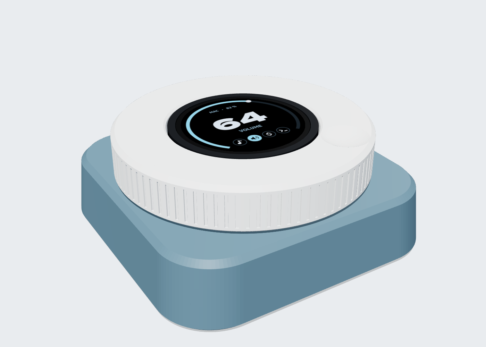
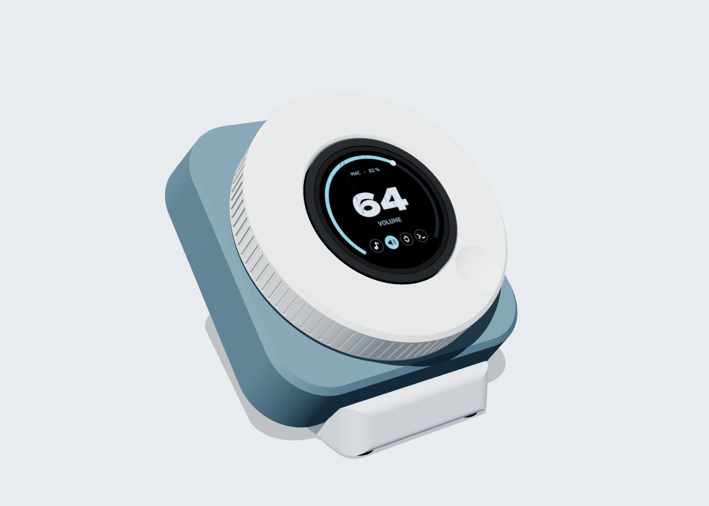
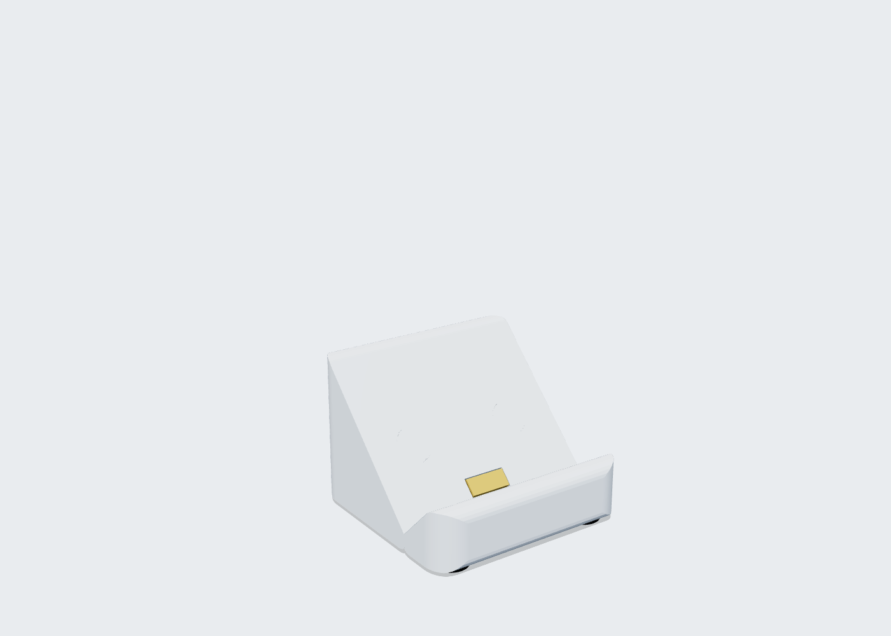
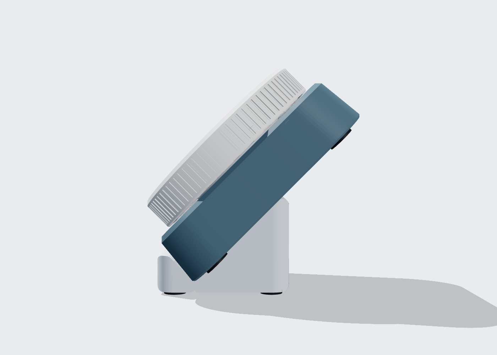
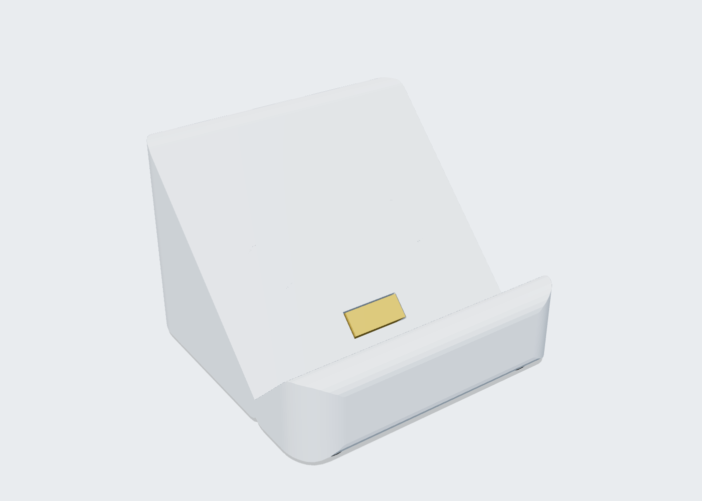
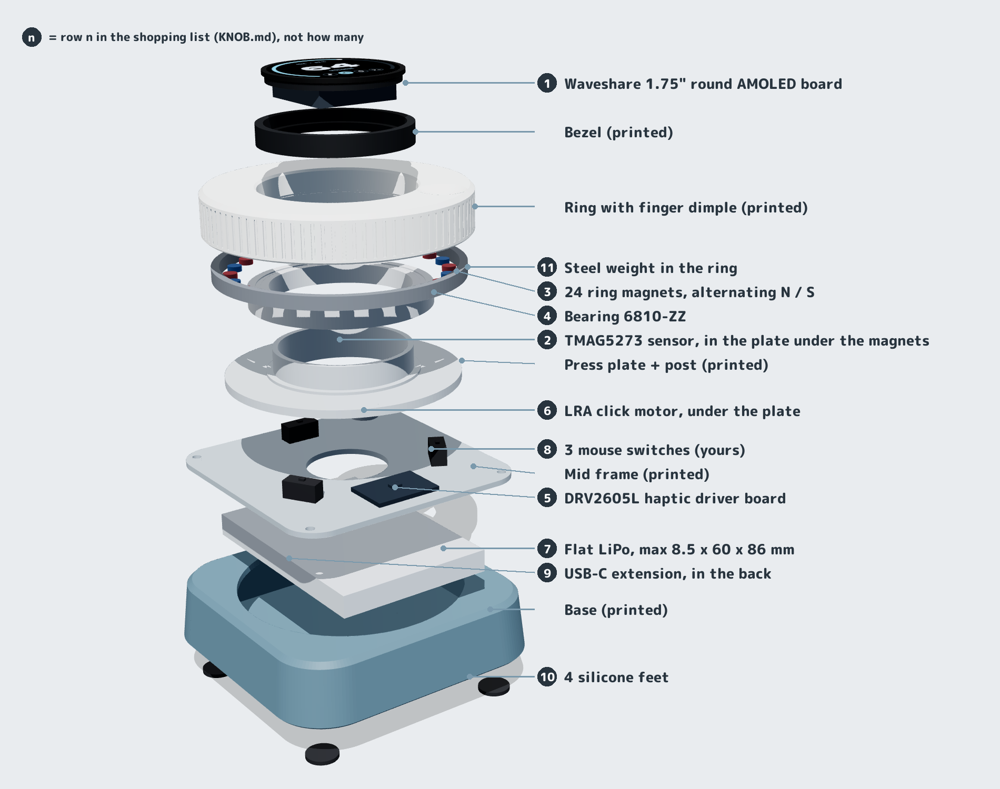

# Desk knob

A wireless knob for the desk. A big printed ring with a finger dimple turns
around a round touch screen. The screen says what the ring does right now
(Spotify, volume, scrolling, terminal history…), so there are no button
combinations to remember. It runs on a battery in a square base, so it can
sit next to the Prospector, by the trackpad or on your knees. A small dock
with a 45° slot holds it like a mixing-desk control, the way headphones sit
in a charging stand.

**Status (2026-11-06): concept only.** Renders to look at and tweak, plus
the shopping list. Nothing has been bought, and there are no print files yet.



| In the 45° dock | Same view, knob taken out |
|---|---|
|  |  |
|  |  |



These are copies in `img/knob/`. `case/knob/build.sh` writes every render
to `case/knob/renders/` (not in git), including `front`, `top`, `cutaway`,
`dock-back` and `screen-ui` (the mock screen), and refreshes these copies.

## To do

- [ ] **You: measure your magnets**: diameter × thickness, and how many you
  have. Their size sets the pockets in the dock and the knob.
- [ ] **Magnets on both sides, so the knob snaps into the dock.** Today the
  dock has 2 magnets that pull on 2 steel discs in the knob's bottom. With
  magnets in the knob too (opposite poles facing), it snaps in harder and
  centres itself. The catch: the knob's floor is only 2 mm, with the battery
  right above it, so magnets thicker than about 2 mm need a small bump inside
  the base or the battery moved back. The model changes once your sizes are in.
- [ ] **You: find a magnetic charging connector** of the kind where one part
  stays in the device for good. Send its measurements: the size and depth of
  the part that stays in the knob, how many contacts it has, and whether it
  carries data.
- [ ] **Then place it:** the part that stays goes flush in the knob's bottom
  near the front edge. There it's hidden when the knob lies on the desk and
  meets the dock when docked. The other part goes in the dock's back face,
  with a USB-C socket in the back of the dock. If it's a magnetic USB-C tip
  that carries data, it could replace the USB-C extension in the back of the
  base: one port for charging off the dock, docking and flashing.
- [ ] The "Before ordering" checks further down.

## What it has to do

- **Battery, never a cable.** It must be free to move around: by the
  Prospector, by the trackpad, on your knees for lazy web surfing. A bigger
  battery is fine.
- **Round touch screen** in the middle. Tap an icon (Spotify, Volume, Scroll,
  Terminal…) to choose what the ring does.
- **A big ring, bigger than the screen, with a finger dimple**, so one finger
  can spin it (scrolling web pages). No big flat knob is for sale, so it's
  printed.
- **Magnet sensing and software clicks.** No EC11-style mechanical encoder.
- **Square base** that holds the battery, in the spirit of the SmartKnob
  View's base.
- **45° dock**: a slot it drops into, like a headphone charging stand, to
  see the screen and use it like a mixing desk. Bad for ergonomics, fine for
  changing the volume or skipping a song. It should be small and hardly
  noticeable when the knob isn't in it.
- *Nice to have:* press the whole knob down to click, using 3–4 spare mouse
  switches.

## How it works

| Part | What it does |
|------|-------------|
| **Ring** (printed, Ø94 × 16 mm) | The knob. The finger dimple (Ø17, 2.5 deep) sits near the edge, the side is knurled, and a steel weight in the underside makes it coast when you flick it. It turns on a thin 6810-ZZ bearing round a fixed centre post. |
| **Screen** (fixed in the middle) | The Waveshare board *is* the computer: an ESP32-S3 with Bluetooth, the touch AMOLED, battery charging with a level readout (AXP2101), and a motion sensor (QMI8658) that can wake it when you pick it up. On an AMOLED, black pixels are off, so a black UI saves battery. |
| **Sensing** | 24 small magnets, alternating N/S, sit in the ring's underside. A TMAG5273 3D Hall sensor below them reads the field's angle, which does one full turn per magnet pair, so you get fine resolution. Nothing touches, so nothing wears and it's silent. The sensor's wake-up mode (~1 µA) wakes the ESP32 when the ring moves. |
| **Clicks** | A DRV2605L haptic driver with an LRA (the Taptic Engine kind of motor) taps once per step: fine ticks for volume, one per line for terminal history, none for free scrolling, a bump at 0 and 100 %. *Option:* real clicks with no power at all, from a small magnet on a slider in the base pulling on the ring's magnets. Slide it away and the ring spins smooth. |
| **Press** (optional) | The ring, screen and press plate float about 0.6 mm on 3 mouse switches wired in parallel, so pressing anywhere clicks. The firmware ignores clicks while the ring is turning. If the board's power-button pin can be reached, the same press could also be on/off (long press). |
| **Battery** | A flat LiPo on the floor of the base. Charging goes through a USB-C extension to the back of the base, or through the dock (below). |
| **45° dock** (printed, 60 × 60 × 42 mm) | A small block with a V-shaped slot. It is narrower than the knob, so it hides behind it, and the knob's feet hang past its sides. The knob's front edge drops into the slot and its bottom rests on the slot's back face. Two magnets under that face pull on two steel discs flush in the knob's bottom (magnets on both sides is on the to-do list), so it snaps in and a tap on the ring can't tip it backwards. The screen centre ends up 71 mm above the desk. |
| **Charging in the dock** | A magnetic charging connector, with one part that stays in the knob for good (a magnetic USB-C tip or a magnetic pogo pair; you're picking one). That part sits flush in the knob's bottom near the front edge, hidden when it lies on the desk. The other part goes in the dock's back face, and a USB-C socket in the back of the dock. The model shows a 12 × 5 mm stand-in. Docking it charges it, like a headphone stand. A diode on each charge input keeps the dock and the USB-C cable apart if both are plugged in. |

**Battery estimate (a guess until measured):** with a 3000 mAh pack and
about an hour of use a day, roughly 2–4 weeks per charge. The drain is
mostly the ESP32 keeping the Bluetooth link alive. It could reach about a
month if it drops to deep sleep after a long idle, at the cost of a 1–2 s
reconnect when you come back.

**Firmware sketch:** ESP32-S3 with Arduino or ESP-IDF, plus LVGL (Waveshare's
examples use LVGL 8.4). It is a Bluetooth HID device: media keys, a mouse
wheel for scrolling and arrow keys for history. It pairs with several
computers, and a screen icon picks which one is active. The screen turns off
after a few seconds and wakes on touch, on turning or on pick-up.

## Shopping list

Prices are rough, in kronor, including VAT and shipping. **Qty** is how
many to buy. The numbered circles on the exploded image are the **#** of
the row here, not how many (so it's 1 sensor, 1 LRA and 1 haptic driver).
**Search for** is what to type in the shop's search box.

| # | Part | Qty | Search for | Notes | ~kr |
|---|------|-----|------------|-------|-----|
| 1 | **Waveshare ESP32-S3-Touch-AMOLED-1.75**, standard version without case | 1 | `ESP32-S3-Touch-AMOLED-1.75` (Waveshare SKU 31261) | Waveshare store, AliExpress (Waveshare's own shop) or The Pi Hut. Check the schematic first, see "Before ordering" | 350–450 |
| 2 | **TMAG5273 3D Hall sensor board**, A2 version | 1 | `Adafruit 6490` | The A2 (±133/266 mT), not the A1: strong magnets 1–2 mm away max out the A1. Add a JST-SH (STEMMA QT/Qwiic) to male-header cable | 100–140 |
| 3 | **The 24 ring magnets: neodymium discs Ø5 × 2 mm, N52, axially magnetised** | 30 (24 + 6 spare) | `S-05-02-N52N` on supermagnete.se, or on AliExpress `neodymium magnet 5x2mm N52` (50-pack) | **Buy these new, all in one batch**, so all 24 are equally strong. Your own (stronger) magnets go in the dock (#13), not the ring: 24 magnets have to fit round the ring about 10 mm apart, so Ø5 is about the limit, and bigger ones would also max out the sensor. supermagnete is about 3–4 kr each, AliExpress less | 40–120 |
| 4 | **Bearing 6810-ZZ** (50 × 65 × 7 mm) | 1 | `6810ZZ bearing` | **ZZ** (metal shields), not 2RS (rubber seals drag). Wash out the grease and add a drop of light oil for a free spin | 50–100 |
| 5 | **DRV2605L haptic driver board** | 1 | `Adafruit 2305`, or on AliExpress `DRV2605L module` | Adafruit's is about 85 kr at RS Sweden; AliExpress clones about 40 kr | 40–85 |
| 6 | **LRA click motor: Vybronics VG1040003D**, 10 mm coin (10 × 4 mm, 170 Hz, 2.5 Vrms) | 1 | `VG1040003D` (DigiKey, Mouser) | About 65 kr at DigiKey. It has contact pads, not wires: solder on two thin wires. **Same size with wires already on:** Precision Microdrives `C10-100` (10 × 3.7 mm, 175 Hz). **Cheap AliExpress option:** `0832 LRA linear vibration motor` (8 × 3.2 mm, 235 Hz, with wires; fits the same spot). It must say **LRA** or "linear": a plain "coin vibration motor" is an ERM and only buzzes. The firmware runs the DRV2605L at the LRA's own frequency (Vybronics advises open-loop at 170 Hz for this one) | 30–70 |
| 7 | **Flat LiPo, ~3000 mAh**, with a protection circuit, **no bigger than 8.5 × 60 × 86 mm** | 1 | `805080 lipo 3000mAh` | The size code reads thickness-width-length: 805080 = 8 × 50 × 80 mm. The board takes a **2-pin MX1.25** plug. **Check the polarity with a multimeter before plugging in**: sellers wire it both ways | 100–150 |
| 8 | Mouse micro switches | 3 | — | **You have these.** Modelled as Omron D2F size (12.8 × 5.8 × 6.5); tell me yours | 0 |
| 9 | **USB-C panel-mount extension**, male to female with screw ears, 15–20 cm, angled male end if possible | 1 | `USB C panel mount extension cable` | Brings charging/flashing to the back of the base | 40–80 |
| 10 | Silicone bumper feet | 8 | `silikonfötter` / `gummifötter` (Clas Ohlson, Biltema) | 4 × Ø12 mm for the knob, 4 × Ø10 mm for the dock | 20–40 |
| 11 | Steel weight: 4.5 mm steel BBs, about 120 g, or M6 nuts | 1 pack | `stålkulor 4,5 mm` | Glued into the ring's underside channel; makes the ring coast when flicked | 30–60 |
| 12 | Wire (28–30 AWG silicone), M3 screws + heat-set inserts, filament | | — | You have these | 0 |
| 13 | Magnets for the dock: 2 in the dock + 2 in the knob | 4 | — | **Your own strong magnets**; measure them first. The model has Ø10 × 3 mm in the dock and steel discs in the knob | 0 |
| 14 | Magnetic charging connector, one part stays in the knob | 1 | `magnetic pogo connector 2 pin` or `magnetic USB C adapter` | You're picking one; its measurements set the pockets | 20–60 |
| 15 | USB-C breakout board (5 V in) | 1 | `USB-C breakout board 5V` | For the back of the dock | 10–20 |

**Total: about 830–1380 kr.** One of each electronic part; only the magnets, feet and steel come in quantities.

### Buy it in two phases

1. **Phase 1, prove the idea** (#1–4 plus a printed test ring, about 550–800 kr):
   the spin, the magnet sensing, the touch UI and Bluetooth scrolling.
2. **Phase 2, make it a device** (#5–11, #13–15): clicks, battery, base, dock.

### Before ordering

- [ ] **Header pins:** Waveshare's pages don't say which pins of the 8-pin
  header carry I2C. The sensor and the haptic driver need I2C, plus one free
  GPIO for the sensor's wake-up interrupt. Read the board's schematic first.
- [ ] **Board size:** get the board's real outline and glass size from
  Waveshare's drawing. The model *assumes* Ø48 glass, a Ø46 board and 6 mm of
  parts behind it (`GLASS_D`, `PCB_D`, `PARTS_H` in `knob.py`).
- [ ] **Switches:** which mouse switches you have (model number or a caliper
  measurement).

## Open questions

- Does a tap from the LRA feel crisp through the bearing? This needs the
  phase-2 prototype. If it doesn't, the LRA moves into the ring itself, which
  then needs a slip contact.
- Magnetic detents yes or no (see "Clicks").
- Tipping: the knob's centre of mass is an estimate (`COM_H`). With it, the
  knob rests about 10 mm inside the dock's tipping edge before the magnets
  even help. Worth checking with the real weight.
- Colours: Shoko for now (white ring, slate base, pale dock). It's one line
  in `knob.py` (`COLOURS`).

## Tweaking the renders

Everything is in `case/knob/knob.py`, with the parameters at the top: ring
size and height, dimple size and position, base width and height, the
dock's angle, width and slot depth, colours. Then run:

```sh
case/knob/build.sh        # model + mock screen + renders, ~1 min (Docker on OMV)
```

`case/knob/report.json` must show 0 for every check (no parts overlapping).
The mock screen comes from `case/knob/ui.py`. The render tools are shared
with the other cases (`case/3d/tools/`).
