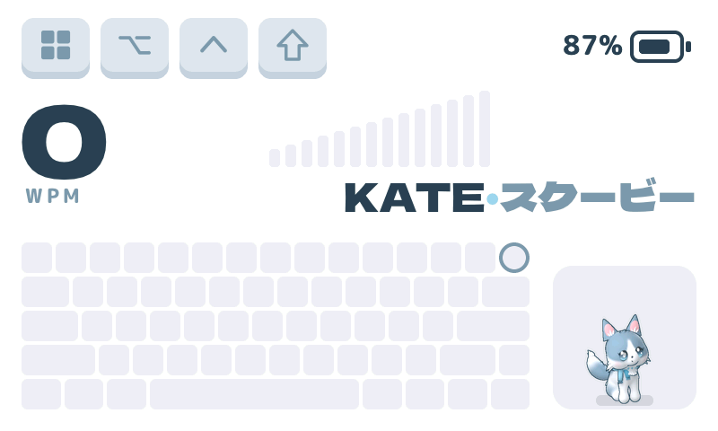
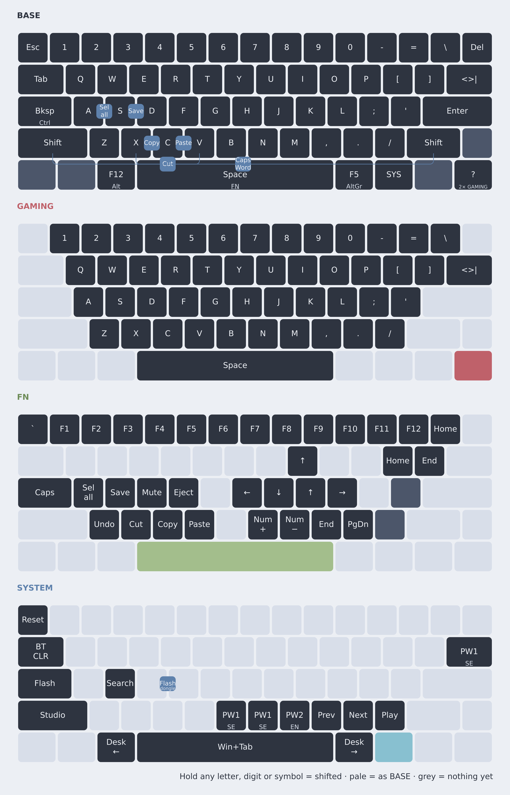
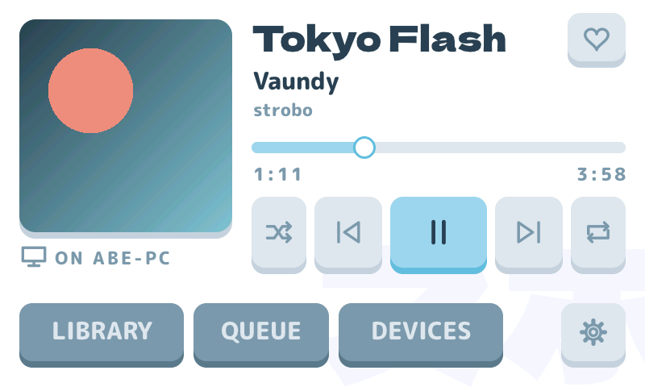
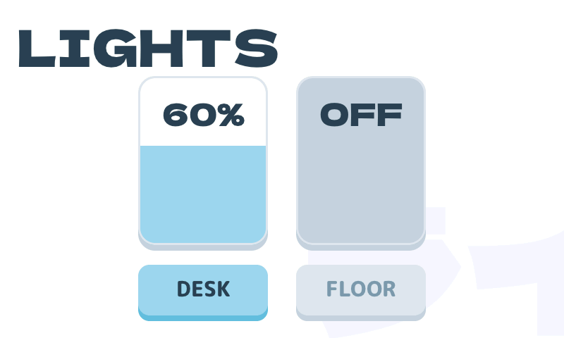
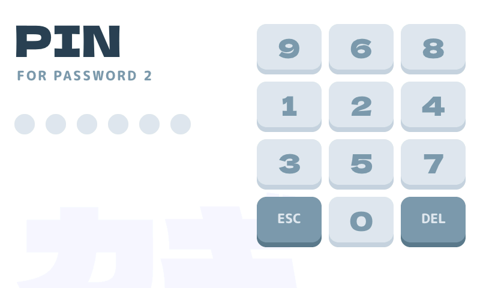
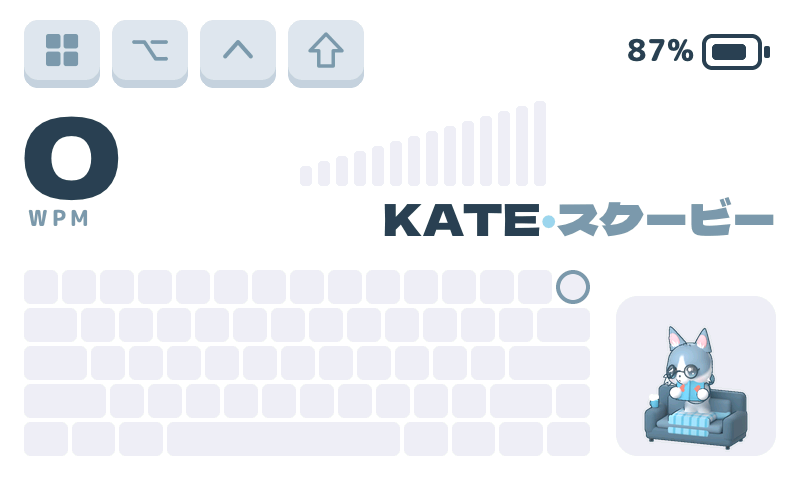

# Cyber60 desk setup

A white **4pplet Cyber60** running [ZMK](https://zmk.dev), with GMK Shoko caps
and a desk screen in the same colours. The screen is the small Prospector
dongle, which now also has a case that hangs under the monitor. A Raspberry
Pi with a 7" touchscreen (the same Shoko screen at 800×480 with a puppy in
the corner, plus Spotify, the desk lamps and a password vault) is built and
parked for later.



## What's here

| Part | What it is | Status |
|------|------------|--------|
| **Keyboard** (`config/`, `boards/4pplet/`) | ZMK config for the Cyber60 rev E (nRF52840). The base layer copies the Rama M60-A, so muscle memory carries over | in use, as the dongle's peripheral |
| **Prospector dongle** (`boards/shields/prospector_*`) | XIAO BLE + 1.69" screen: holds the keymap, draws the Shoko screen, runs ZMK Studio | in use |
| **Desk screen** (`pi/`) | Raspberry Pi 4 + official 7" Touch Display: the Shoko screen, a 3D corgi, Spotify, Shelly lights, a password vault, updates over USB | runs on the Pi; parked 2026-11-05, keyboard link half built |
| **Cases** (`case/`) | `case/3d/`: a giant Shoko keycap for the Prospector. `case/monitor/`: the Prospector taped under the monitor, only the screen showing. `case/deck/`: a picture-frame case for the desk screen | designed; test prints next |
| **Desk knob** ([KNOB.md](KNOB.md), `case/knob/`) | Battery Bluetooth knob: a big printed ring with a finger dimple turning round a round touch screen, a square battery base, and a 45° stand | concept renders + shopping list; nothing bought |

## How it fits together

Today:

```
Computer ←USB── Prospector dongle (keymap, screen, Studio)
                    └──BLE── Cyber60 (keys, encoder, battery, underglow)
```

Later, with the desk screen (parked; the firmware for it is `tools/build.sh
keyboard-pi`):

```
Cyber60 ──BLE──► Pi desk screen ──USB (a plain keyboard)──► any computer
(keymap)          screen, Spotify, lights, password vault
```

The keymap moves back onto the keyboard, the Pi passes the keys on to the
computer, and the computer sees an ordinary USB keyboard: no drivers, no
software, nothing installed. The Pi's wifi only ever reaches the internet
(Spotify, the Shelly cloud), never the computer or its network.

## The keyboard

| # | Layer | How | Underglow |
|---|-------|-----|-----------|
| 0 | BASE | default. Letters, digits and symbols **auto-shift** (hold 175 ms) | off |
| 1 | SCROLL | press the encoder (toggle): it scrolls instead of changing volume | purple |
| 2 | GAMING | double-tap the bottom-right corner key (toggle): plain keys, no combos | red |
| 3 | FN | hold Space: F-keys, arrows on HJKL, ^Z/^X/^C/^V, Home/End | green |
| 4 | SYSTEM | hold SYS: media, desktops, Win+Tab, passwords, bootloader, Studio unlock | blue |

**Combos** (BASE and SCROLL): A+S = Ctrl+A, S+D = Ctrl+S, X+C = copy,
C+V = paste, X+V = cut, both Shifts = Caps Word.

The keymap is `config/cyber60.keymap` (the layer order matters: see the
comment at its top). The dongle's `prospector_dongle.keymap` just includes
it, and so does the Pi variant. `tools/draw.sh` redraws `img/cyber60.png` from it,
with [keymap-drawer](https://github.com/caksoylar/keymap-drawer) in Docker.



## The screens

**Shoko**: the three Pantones on GMK Shoko's kit sheet (656 C pale, 5425 C
slate, 2975 C aqua) on white. Each layer gets its own scene with a huge pale
katakana word behind it, and a keycap-row wipe runs between layers. A mini
keyboard echoes your presses, and modifiers show as keycaps. On the
Prospector: `boards/shields/prospector_screen/src/layouts/shoko/`, previewed
without flashing by `tools/shoko/preview.sh`.

The **desk screen** has the same scenes at 800×480, sharing `shoko_theme.h`
and `shoko_keys.h` with the Prospector, and swipes sideways to more:

| | |
|---|---|
|  |  |
| **Spotify**: player, library, queue, devices; login by QR code on a phone | **Lights**: Shelly lamps through the Shelly cloud, a fader and a switch each |
|  |  |
| **Password vault**: a PIN on a scrambled numpad plus a key only the keyboard holds | **The corgi** reacts to your typing speed, reads, watches TV and sleeps when you're away |

Everything about it, from the SD card image to the DECK drive that updates it
over USB, is in **[pi/README.md](pi/README.md)**. `pi/tools/preview.sh`
renders the whole screen on a PC, without a Pi.

## Building and flashing

**Keyboard and dongle.** GitHub Actions (`build.yaml`) builds the keyboard,
the dongle and two settings-reset images on every push, **without** the
password macros. Builds with passwords are made locally on the OMV box, in
ZMK's own Docker image:

```bash
tools/build.sh              # keyboard + dongle + settings_reset → firmware/
tools/build.sh dongle       # just the dongle
tools/build.sh keyboard-pi  # the standalone keyboard for the Pi desk screen
tools/build.sh update       # refresh ZMK/Zephyr (pinned to ZMK main in config/west.yml)
```

| File | Flash to |
|------|----------|
| `firmware/cyber60.uf2` | the keyboard, as the dongle's peripheral: SYSTEM + Flash (the Ctrl/Bsp key), or double-tap reset, then drag the file onto the drive |
| `firmware/dongle.uf2` | the Prospector: double-tap the XIAO's reset, drag the file |
| `firmware/reset-*.uf2` | either, to wipe Bluetooth bonds; then flash the normal file |
| `firmware/cyber60-pi.uf2` | the keyboard, standalone for the Pi desk screen (later) |

To pair from scratch: flash both resets, let each boot once, flash the normal
files, plug the dongle in first, then switch the keyboard on. Switching the
keyboard between the dongle and the Pi always needs that: it remembers the
other one otherwise. `tools/flash.sh` flashes the keyboard through the Pi
when it hangs off one of the Pi's USB ports.

**ZMK Studio** runs on the dongle: plug it in, open <https://zmk.studio>,
press SYSTEM + Left Shift to unlock, and remap without reflashing. (VIA and Vial
are QMK things and don't work with ZMK.) Studio costs about 15 KB of the
XIAO's RAM; if the dongle ever acts up, try `CONFIG_ZMK_STUDIO=n` first.

**Desk screen.** GitHub Actions (`pi-image.yml`, **Pi screen**) builds an update
whenever `pi/` changes; the SD card image only when run by hand with *image*
ticked. Flash the image with Raspberry Pi Imager ("Use custom"). After that,
updates and settings go onto the **DECK** USB drive the Pi shows on the
computer (or the SD card's `bootfs`): drop the download as it is, eject, and
the screen restarts with it in about a second.

## Secrets

This repository is public, and so are its GitHub Actions artifacts, which
anyone with a GitHub account can download. So no secret goes into git or CI:

- **Password macros** (until the vault replaces them): `config/secrets/` is
  gitignored. `python3 tools/make-passwords.py` asks for each password at a
  hidden prompt and writes `passwords.dtsi` (mode 600); build it with
  `tools/build.sh dongle`, never in CI. A macro sends key positions, so each
  one is made for the keyboard layout the computer uses (`--pw1`/`--pw2`).
- **The desk screen** keeps everything on the Pi, root-only: the wifi
  password and Spotify login (entered on the screen), the Shelly key (moved
  out of `deck.conf` the moment it arrives) and the password vault. The image
  and the update file hold none of it.
- **The password vault** replaces the macros once the keyboard link exists.
  The keyboard then holds no password at all, only a random key that the Pi
  needs together with your PIN. See [pi/README.md](pi/README.md#password-vault).

## Repository map

```
config/                 keymap, combos, behaviors, .conf files; secrets/ (gitignored)
boards/4pplet/cyber60/  the Cyber60 board definition (from 4pplet, two marked local changes)
boards/shields/         prospector_dongle (central) + prospector_screen (Shoko and Operator layouts)
src/, drivers/, include/, dts/   ZMK modules: layer glow, caps word, screen events
tools/                  build.sh, draw.sh, make-passwords.py, shoko/ (screen assets + preview)
draw/                   the keymap drawing's sources (keymap-drawer); screen previews are generated, not in git
img/                    the pictures in this README
pi/                     the desk screen: app/ (LVGL), image/ (SD card), tools/
case/3d/                the Prospector's keycap case (parametric, manifold3d)
case/monitor/           the Prospector's under-monitor case (same tools)
case/deck/              the desk screen's case
docs/spotify/           the GitHub Pages hop for the desk screen's Spotify login
```

## Next

Items 1 to 4 wait until the desk screen comes back.

1. **The keyboard link**: the Pi pairs with the Cyber60 over Bluetooth and
   becomes a USB keyboard for the computer; the keymap moves onto the
   keyboard; the password keys and the vault's key come over the link. The
   vault goes live with it, and the old macros go.
2. **A real Shelly bulb** for the Lights page (tested so far against a
   stand-in for the Shelly cloud).
3. **The desk screen's case** (`case/deck/README.md` lists the measurements).
4. A read-only system on the Pi, so pulling the plug can never damage it.
5. Keymap odds and ends: the `&none` keys marked TODO in the keymap, a home
   for **Del** (top right on the M60-A, where the encoder is now), and whether
   the M60-A's `~/.` macro comes along.

## Where things come from

- `boards/4pplet/cyber60/`, `dts/bindings/buzzer/`: the Cyber60 board from
  [4pplet/zmk-config-4pplet](https://github.com/4pplet/zmk-config-4pplet) (MIT),
  with two marked local changes so it can run as a split peripheral:
  `CMakeLists.txt` skips the Bluetooth-profile LED code, and
  `Kconfig.defconfig` only defaults USB HID on when the board is the central.
  Re-apply both if you update from 4pplet.
- `boards/shields/prospector_screen/`, `drivers/`, `include/`, `src/events`,
  `src/split`, `src/behaviors/behavior_caps_word.c`: the screen code from the
  KLOR repo, itself based on
  [carrefinho/prospector-zmk-module](https://github.com/carrefinho/prospector-zmk-module)
  (MIT). Kconfig options keep their `CONFIG_PROSPECTOR_*` names, and the
  dongle shields are called `prospector_*` on purpose: ZMK also tries a
  shield's name with suffixes stripped, so `cyber60_dongle` would load the
  keyboard's own `cyber60.conf`.
- Fonts: Dela Gothic One and M PLUS Rounded 1c (SIL Open Font License).
- The desk screen builds on [LVGL](https://lvgl.io) 9.3 (MIT),
  [cJSON](https://github.com/DaveGamble/cJSON) (MIT) and
  [Monocypher](https://monocypher.org) (CC0 / BSD-2), fetched at build time
  by `pi/tools/fetch-deps.sh`.
